[TOC]

# 1. Instalación del sistema

## 1.1 Arquitectura

QuetzalMart funciona en **una máquina virtual de la nube** con Ubuntu 24.04. Dentro de ella,
Docker ejecuta tres contenedores:

| Componente | Imagen | Función |
|---|---|---|
| Base de datos | `postgres:16-alpine` | Base de datos relacional centralizada `quetzalmart` (todas las sucursales). Solo escucha dentro de la VM. |
| ERP | `odoo:18.0` | Odoo Community 18 con los módulos del proyecto y los módulos propios `qm_*`. |
| Servidor web | `caddy:2.8-alpine` | Publica Odoo por HTTPS (certificado de Let's Encrypt automático). |

Fuera de la nube se usan: **UiPath Studio** (RPA, en una PC con Windows), **Google Analytics 4**
(métricas de la tienda), **DBeaver** (consultas SQL por túnel SSH) y una cuenta de correo de la
empresa para los envíos.

| Requisito del enunciado | Implementación |
|---|---|
| Odoo Community en la nube | Odoo 18 Community en una instancia EC2 de AWS |
| Base de datos relacional en la nube | PostgreSQL 16 en la misma VM (Odoo solo admite PostgreSQL) |
| Plataforma en la nube | Amazon Web Services (EC2, región Ohio) |
| UiPath para RPA | Proyecto `rpa/QuetzalMart_Robot` |
| Google Analytics | GA4 con comercio electrónico (módulo `qm_ga4_ecommerce`) |
| Gestor documental integrado a Odoo | OCA DMS 18 + módulo `qm_gestion_documental` |

## 1.2 Requisitos

* Cuenta de AWS (capa gratuita con créditos).
* Instancia EC2 de 2 vCPU, 4 GiB de RAM y 30 GiB de disco con puertos 22, 80 y 443 abiertos.
* El repositorio del proyecto (carpeta `proyecto_sog2_quetzalmart`).
* En la PC: Python 3.10+ (para la carga de datos), UiPath Studio y DBeaver.

## 1.3 Crear la máquina virtual

En la consola de AWS (región Ohio) ► EC2 ► **Lanzar instancia**:

| Opción | Valor |
|---|---|
| AMI | Ubuntu Server 24.04 LTS, 64 bits (x86) |
| Tipo de instancia | `c7i-flex.large` (2 vCPU, 4 GiB) |
| Par de claves | `Geren2` (archivo `.pem`) |
| Grupo de seguridad | SSH 22, HTTP 80 y HTTPS 443 |
| Almacenamiento | 30 GiB gp3 |
| IP | IP elástica asociada a la instancia (`3.132.57.160`) |

El dominio público es `quetzalmart.3-132-57-160.sslip.io` (sslip.io resuelve la IP sin comprar
un dominio) y Caddy obtiene el certificado HTTPS de Let's Encrypt.

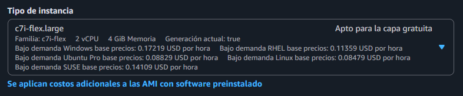
<p class="pie">Figura 1. Tipo de instancia c7i-flex.large (2 vCPU, 4 GiB), apto para la capa gratuita.</p>

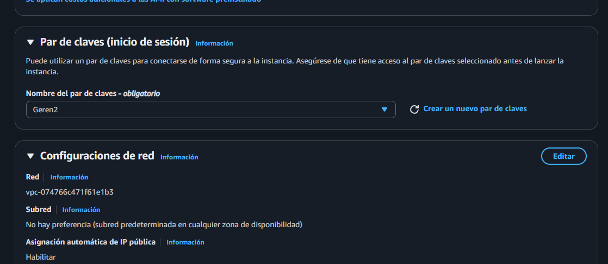
<p class="pie">Figura 2. Par de claves Geren2 y red con IP pública.</p>

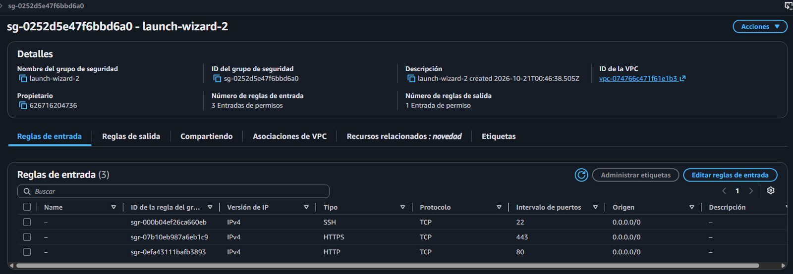
<p class="pie">Figura 3. Grupo de seguridad: SSH (22), HTTP (80) y HTTPS (443).</p>

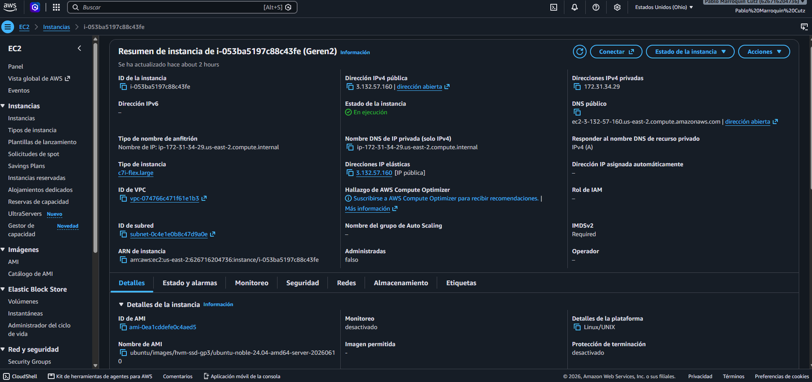
<p class="pie">Figura 4. Instancia en ejecución con Ubuntu 24.04 e IP elástica 3.132.57.160.</p>

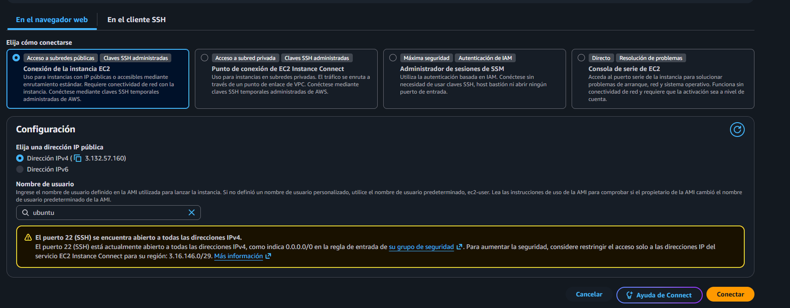
<p class="pie">Figura 5. Conexión a la instancia desde la consola de AWS (usuario ubuntu).</p>


## 1.4 Instalar QuetzalMart con un solo comando

Desde la VM (conexión SSH):

```bash
sudo apt-get update && sudo apt-get install -y git
git clone -b claude/clever-turing-8emaf6 https://github.com/PabloMarroquinnn1/Geren2.git
cd Geren2/proyecto_sog2_quetzalmart/nube
sudo ./instalar.sh                 # usa <ip>.sslip.io como dominio
```

El script `instalar.sh` realiza ocho pasos y puede repetirse sin perder datos:

| Paso | Qué hace |
|---|---|
| 1 | Instala Docker, Docker Compose y Git si faltan. |
| 2 | Crea `nube/.env` con el dominio y contraseñas aleatorias (base de datos, clave maestra, administrador y usuario de solo lectura). |
| 3 | Descarga el módulo OCA DMS (gestión documental) en una versión fija. |
| 4 | Genera `odoo.conf`: una sola base `quetzalmart`, sin administrador público de bases, 2 workers y 2 hilos de tareas programadas. |
| 5 | Inicia PostgreSQL y espera a que esté listo. |
| 6 | Crea la base en **español latinoamericano**, prepara la compañía en Guatemala con quetzales, instala la contabilidad de Guatemala (`l10n_gt`: plan contable e IVA) y luego `qm_implementacion`, que instala y configura todo lo demás. |
| 7 | Crea el usuario de PostgreSQL `consulta` de **solo lectura** para la calificación. |
| 8 | Inicia Odoo y Caddy y espera el certificado HTTPS. Muestra la URL y las credenciales. |

Al terminar muestra un resumen como este (las claves reales quedan en `nube/credenciales.txt`,
que no se sube al repositorio):

```text
==> Listo
URL:            https://quetzalmart.3-132-57-160.sslip.io
Base de datos:  quetzalmart
Usuario Odoo:   admin@quetzalmart.com
Clave Odoo:     ********************
PostgreSQL (túnel SSH, puerto 5432 de la VM):
  usuario consulta / ********   (solo lectura)
```


## 1.5 Qué deja configurado el módulo `qm_implementacion`

* **Compañía QuetzalMart** en Guatemala, moneda quetzal (formato `Q 1,250.50`), plan contable e
  IVA del 12 % de Guatemala, logotipo y documentos con los colores de la marca.
* **Tres sucursales** (almacenes `GUA`, `MEX`, `SAL`) con dirección propia y seis sectores cada
  una, y **reglas de ubicación** que guardan cada categoría en su sector.
* **Equipos de venta** por sucursal y el equipo *Tienda en línea*; leads activados en el CRM.
* **Tienda en línea** con portada propia, seis categorías, precios con IVA incluido, cuenta
  opcional, registro libre, envío a domicilio (Q30, gratis desde Q350), envío regional a México y
  El Salvador, recoger en sucursal y **pago con tarjeta de prueba**.
* **Compras** mayores a Q 10,000 con aprobación de un gerente.
* **Gestión documental:** carpeta *Archivo QuetzalMart* con subcarpetas, categorías y etiquetas.
* **Marketing:** plantillas de correo propias, listas de correo, campaña masiva y código de
  descuento **QUETZAL10**.

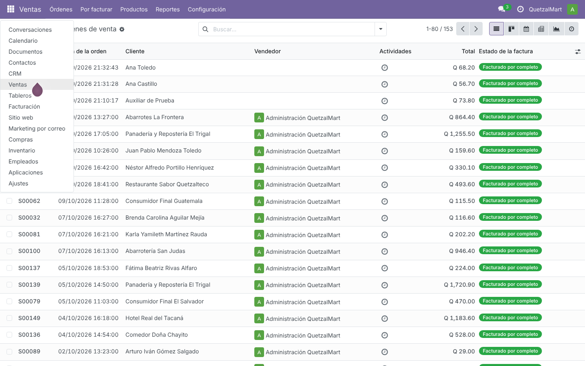
<p class="pie">Figura 6. Aplicaciones de Odoo instaladas para QuetzalMart.</p>

## 1.6 Cargar los datos, el correo y Google Analytics

Desde la PC del grupo (más detalle en `docs/02_carga_de_datos.md` y `docs/04_correo_y_marketing.md`):

```bash
pip install openpyxl reportlab
python carga_masiva/cargar_quetzalmart.py --url https://SU-DOMINIO --clave CLAVE_ADMIN \
    --ga4 G-XXXXXXXXXX --correo-remitente ventas.quetzalmart@gmail.com \
    --smtp-servidor smtp.gmail.com --smtp-usuario ventas.quetzalmart@gmail.com --smtp-clave "CLAVE APP"
```

## 1.7 Acceso a la base de datos desde DBeaver

PostgreSQL no se expone a Internet. En DBeaver: conexión PostgreSQL a `localhost:5432`, base
`quetzalmart`, usuario `consulta`, y en la pestaña **SSH** un túnel a la IP de la VM con la clave
privada. Las consultas preparadas están en `sql/consultas_calificacion.sql`.

## 1.8 Mantenimiento

| Tarea | Comando en `nube/` |
|---|---|
| Actualizar módulos tras un cambio | `sudo ./actualizar.sh` |
| Respaldo de base y archivos | `sudo ./respaldo.sh` |
| Consola SQL de solo lectura | `sudo ./consola_sql.sh` |
| Registros de Odoo | `sudo docker compose logs -f odoo` |

# 2. Funcionamiento de cada módulo

## 2.1 Ventas

Gestiona cotizaciones y pedidos de las tres sucursales y de la tienda en línea. Cada pedido indica
el almacén que entrega y el equipo de ventas (sucursal). Al confirmar una cotización se reserva el
inventario; desde el pedido se crea la factura. **Menús:** Ventas ► Órdenes ► Cotizaciones / Órdenes.

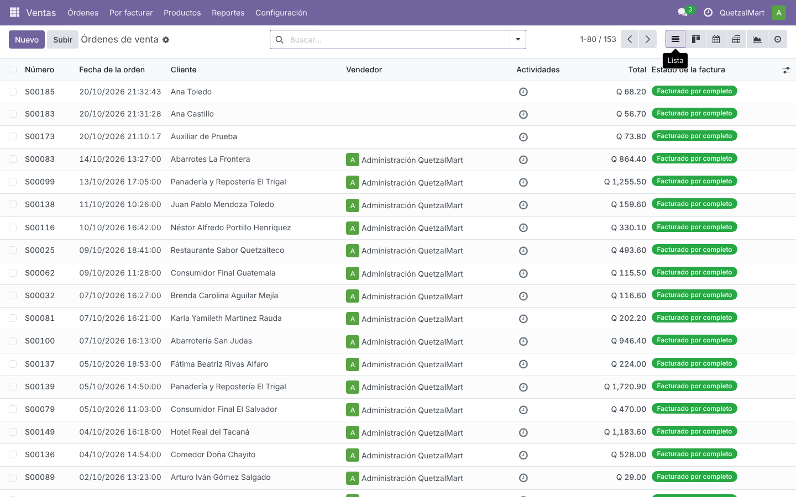
<p class="pie">Figura 7. Listado de pedidos de venta.</p>

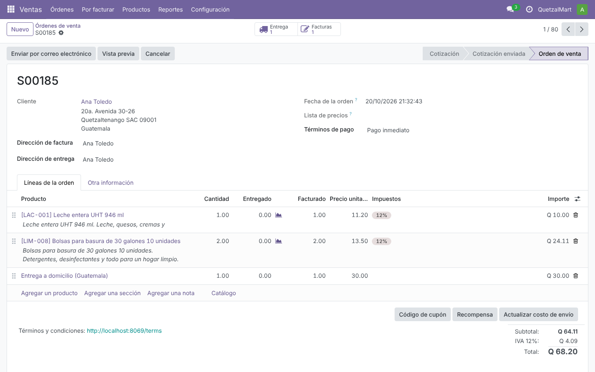
<p class="pie">Figura 8. Pedido de venta con productos, IVA, envío, entrega y factura.</p>

## 2.2 Compras

Solicitudes de cotización a proveedores, órdenes de compra (con aprobación sobre Q 10,000),
recepciones en la sucursal y facturas del proveedor. **Menús:** Compras ► Pedidos.

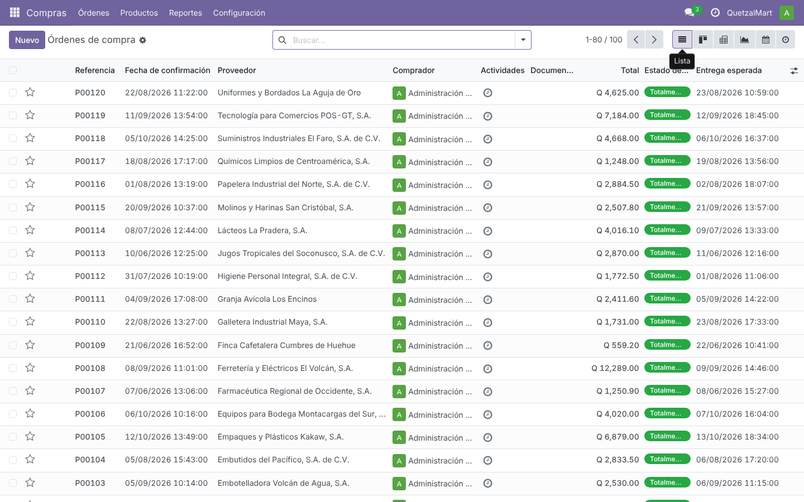
<p class="pie">Figura 9. Solicitudes de cotización y órdenes de compra.</p>

## 2.3 Inventario

Tres almacenes con seis sectores cada uno. Las reglas de ubicación envían cada categoría a su
sector al recibir mercadería; los conteos se registran en *Inventario físico*.

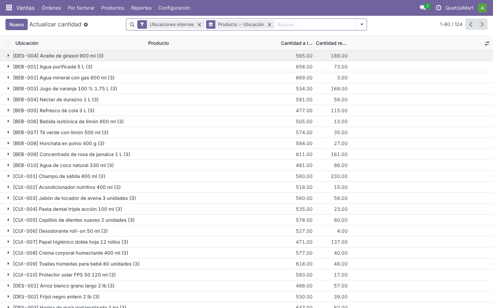
<p class="pie">Figura 10. Existencias por sucursal y sector.</p>

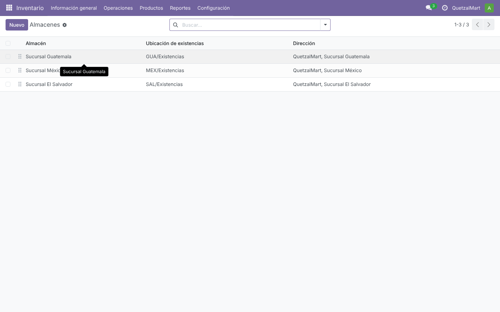
<p class="pie">Figura 11. Las tres sucursales como almacenes de una sola compañía.</p>

## 2.4 Facturación y contabilidad

Facturas de cliente y de proveedor con el IVA de Guatemala, pagos y estado de cobro. Cada factura
de cliente publicada guarda su PDF en el gestor documental de forma automática.

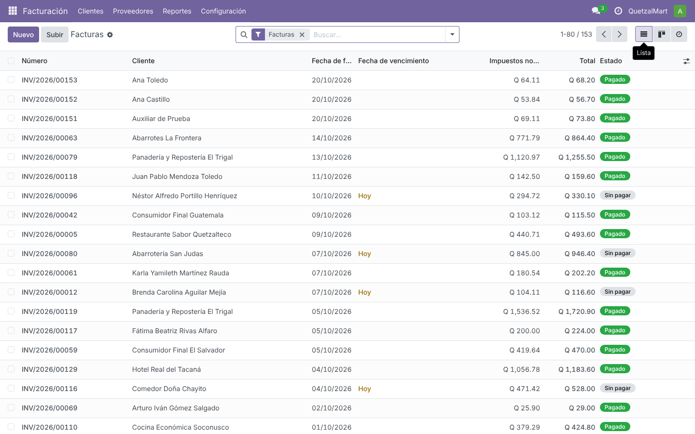
<p class="pie">Figura 12. Facturas de clientes con su estado de pago.</p>

## 2.5 Empleados y contratos

Cinco departamentos, siete puestos y 35 empleados con su sucursal (ubicación de trabajo), jefe
inmediato, DPI y contrato vigente. **Menús:** Empleados ► Empleados / Departamentos / Contratos.

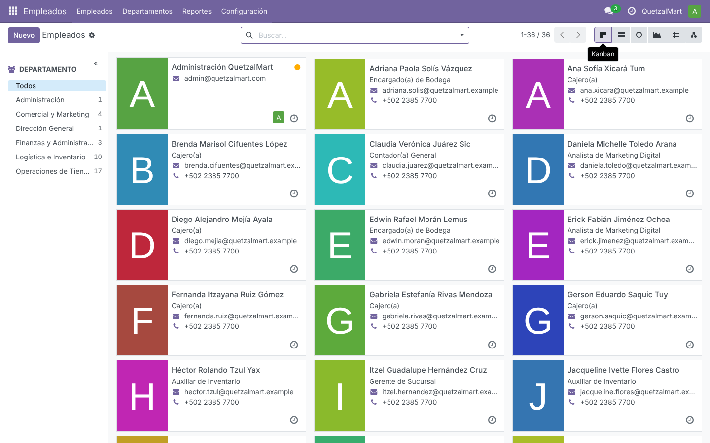
<p class="pie">Figura 13. Directorio de empleados.</p>

## 2.6 CRM

Embudo de oportunidades por etapa y equipo, leads de los registros en la tienda y oportunidades
ganadas generadas por cada compra en línea.

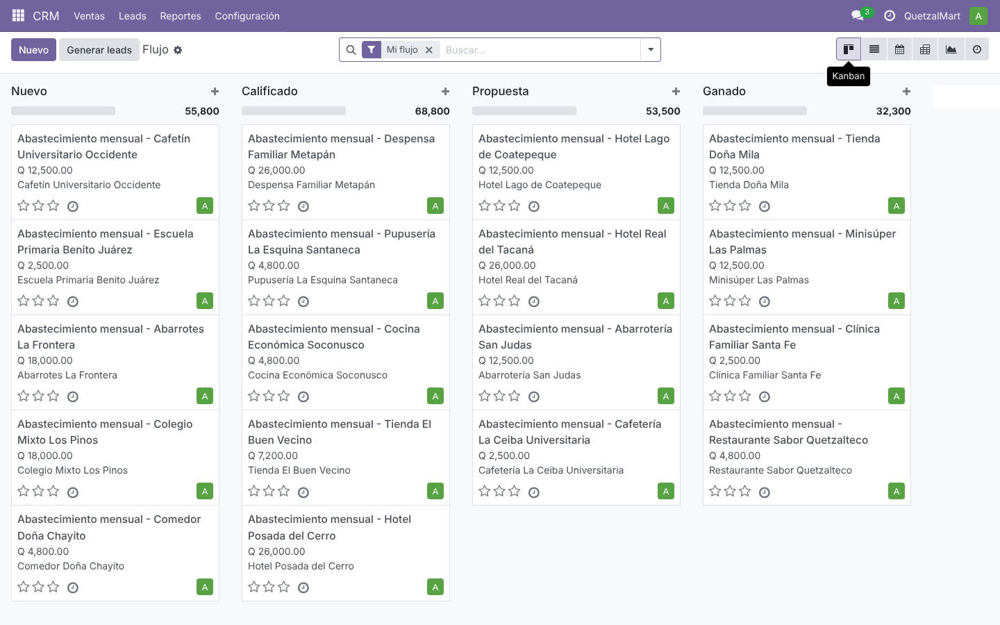
<p class="pie">Figura 14. Embudo del CRM con las oportunidades de clientes empresariales.</p>

## 2.7 Sitio web y comercio electrónico

Portada, catálogo de 60 productos con imagen, carrito con IVA y envío, pago y confirmación. Está
conectado al ERP (pedidos, inventario y facturas) y al CRM (leads y oportunidades), y envía los
eventos de comercio electrónico a Google Analytics 4.

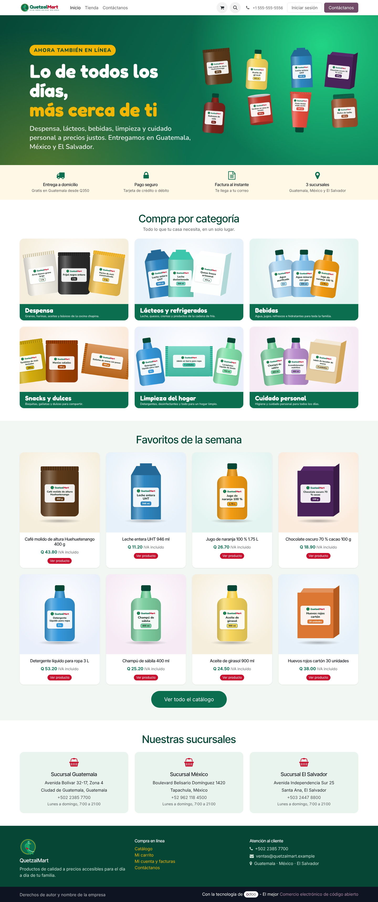
<p class="pie">Figura 15. Página de inicio de la tienda en línea.</p>

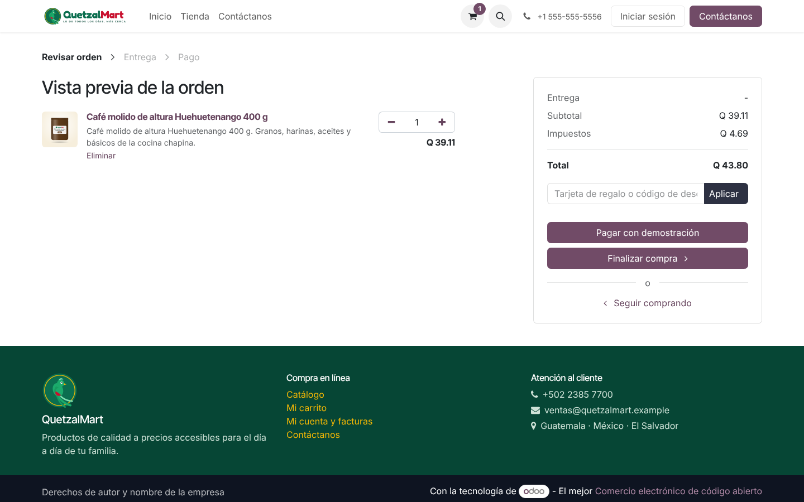
<p class="pie">Figura 16. Carrito con subtotal, impuestos y total.</p>

## 2.8 Marketing por correo

Listas de correo (*Clientes QuetzalMart*, *Clientes tienda en línea*, *Registros web*), la campaña
masiva de temporada y las plantillas del comprobante y de la campaña postcompra.

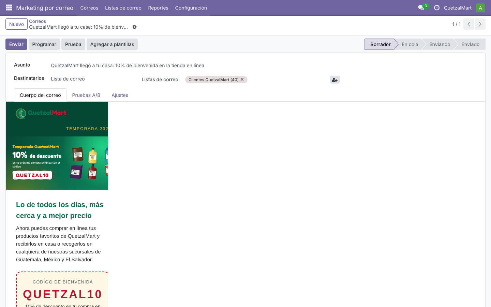
<p class="pie">Figura 17. Campaña masiva lista para enviarse a la lista de clientes.</p>

Al comprar en la tienda el cliente recibe, desde `ventasquetzalmart@gmail.com`, primero la
confirmación del pedido y el **comprobante de compra** con la factura en PDF, y menos de un minuto
después el correo de la **campaña** con el código QUETZAL10 y productos recomendados; cada uno con
un asunto distinto.

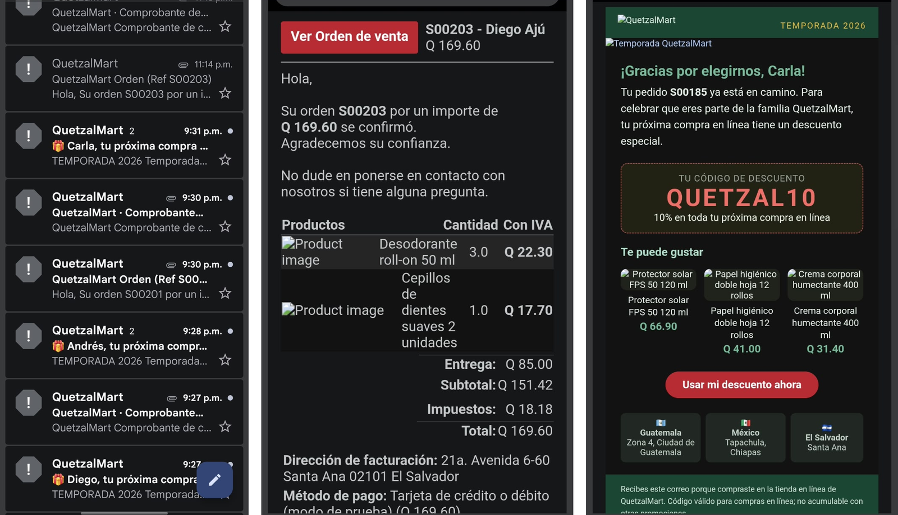
<p class="pie">Figura 18. Bandeja del cliente, confirmación del pedido (con IVA y envío) y correo de la campaña QUETZAL10.</p>

## 2.9 Documentos (gestión documental)

Repositorio centralizado con carpetas, categorías y etiquetas: facturas de venta (automáticas),
facturas de proveedores, contratos de outsourcing, contratos de empleados y reportes.

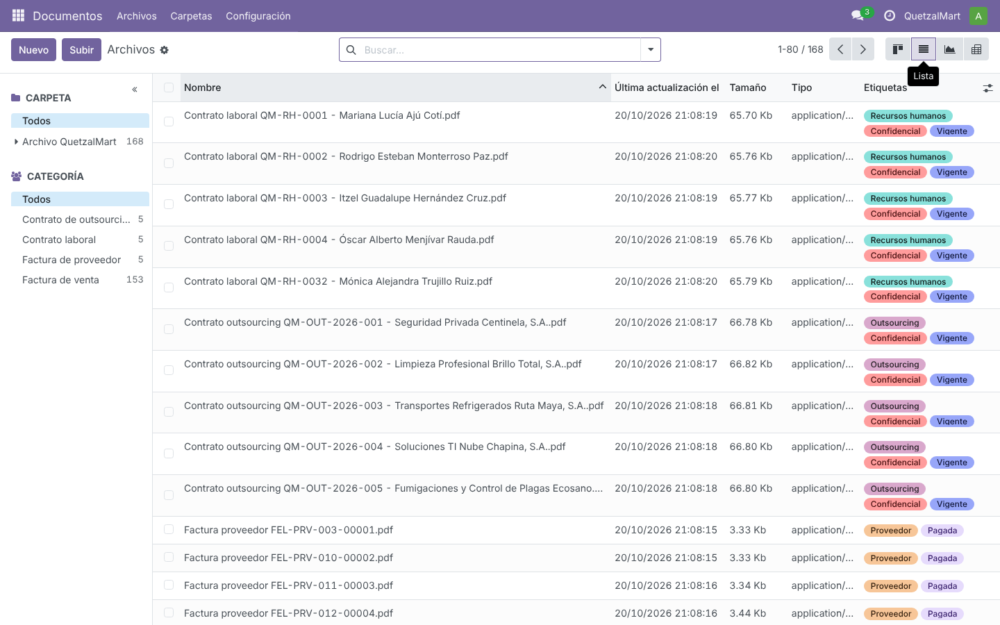
<p class="pie">Figura 19. Documentos con categoría y etiquetas para filtrarlos.</p>

## 2.10 Módulos propios

| Módulo | Qué agrega |
|---|---|
| `qm_implementacion` | Instala y configura toda la implementación (sección 1.5). |
| `qm_puente_rpa` | Campos para que el robot cargue cantidad a la mano, país, estado, empresa, etiquetas y sitio web como texto; guarda el archivo de origen. |
| `qm_gestion_documental` | Estructura del archivo y PDF automático de cada factura publicada. |
| `qm_ga4_ecommerce` | Completa el embudo de GA4 (`begin_checkout`, `view_cart`, `remove_from_cart`, `add_shipping_info`, `add_payment_info`) y usa el SKU como identificador. |
| `qm_crm_postventa` | Registro web y compras al CRM, comprobante con diseño propio y campaña postcompra. |

# 3. Carga masiva de información

## 3.1 Cómo se importa un archivo en Odoo

1. Abrir la lista del módulo (por ejemplo *Contactos*) ► engranaje ► **Importar registros**.
2. **Subir archivo de datos** y elegir la plantilla de `carga_masiva/plantillas/`.
3. Revisar que cada columna se relacionó con su campo (los encabezados son nombres técnicos).
4. **Probar**. Si dice *Todo parece correcto*, pulsar **Importar**.

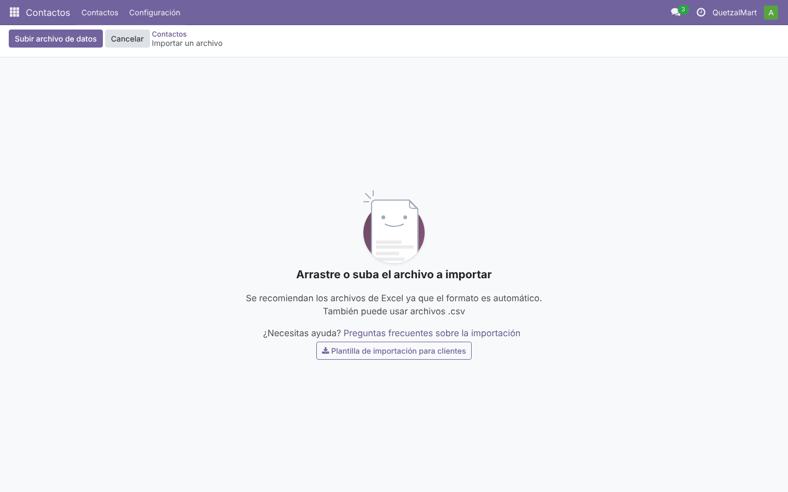
<p class="pie">Figura 20. Pantalla de importación.</p>

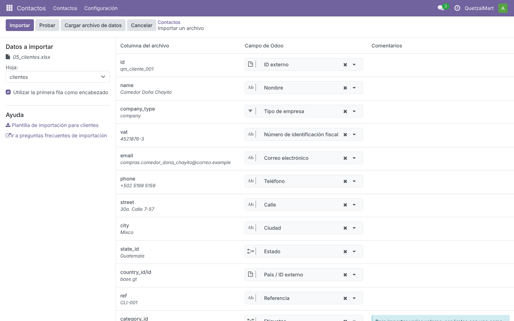
<p class="pie">Figura 21. Cada columna de la plantilla relacionada con su campo de Odoo.</p>

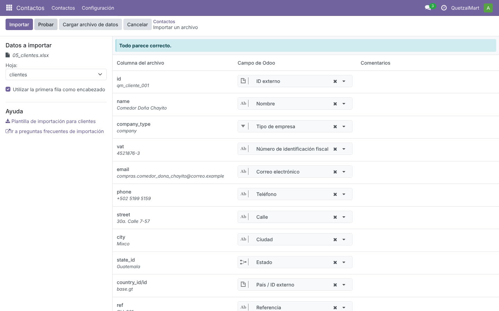
<p class="pie">Figura 22. Resultado de Probar antes de importar.</p>

## 3.2 Plantillas por módulo

| Orden | Plantilla | Módulo y menú | Registros |
|---|---|---|---|
| 1 | `01_departamentos.xlsx` | Empleados ► Departamentos | 5 |
| 2 | `02_puestos.xlsx` | Empleados ► Configuración ► Puestos | 7 |
| 3 | `03_empleados.xlsx` | Empleados | 35 |
| 4 | `04_contratos.xlsx` | Empleados ► Contratos | 35 |
| 5 | `05_clientes.xlsx` | Contactos | 40 |
| 6 | `06_proveedores.xlsx` | Contactos | 30 |
| 7 | `07_productos.xlsx` | Inventario ► Productos | 60 |
| 8 | `08_materiales_operativos.xlsx` | Inventario ► Productos | 60 |
| 9 | `09_existencias_iniciales.xlsx` | Inventario ► Inventario físico (luego *Aplicar*) | 360 |
| 10 | `10_oportunidades_crm.xlsx` | CRM | 18 |

Las transacciones (20 cotizaciones de venta, 20 solicitudes de cotización, 100 compras con
recepción y factura, 150 ventas con entrega, factura y pago) se generan con
`cargar_quetzalmart.py --paso transacciones`, que usa los mismos procesos de Odoo que se describen
a continuación.

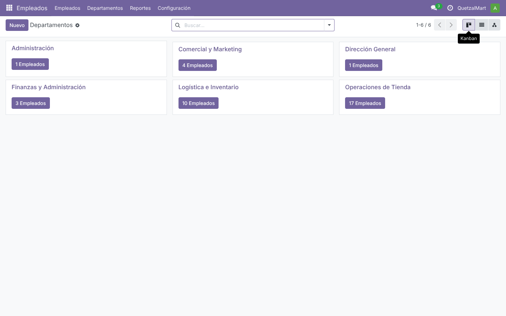
<p class="pie">Figura 23. Departamentos cargados.</p>

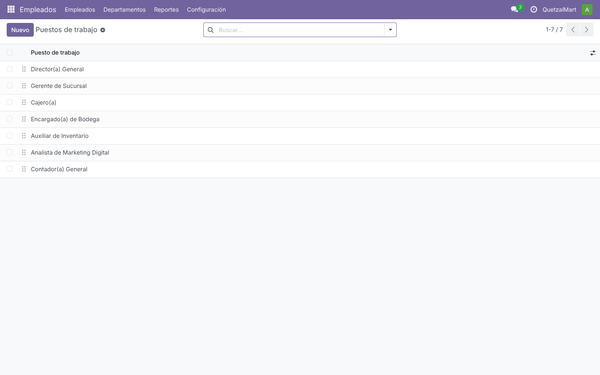
<p class="pie">Figura 24. Puestos de trabajo.</p>

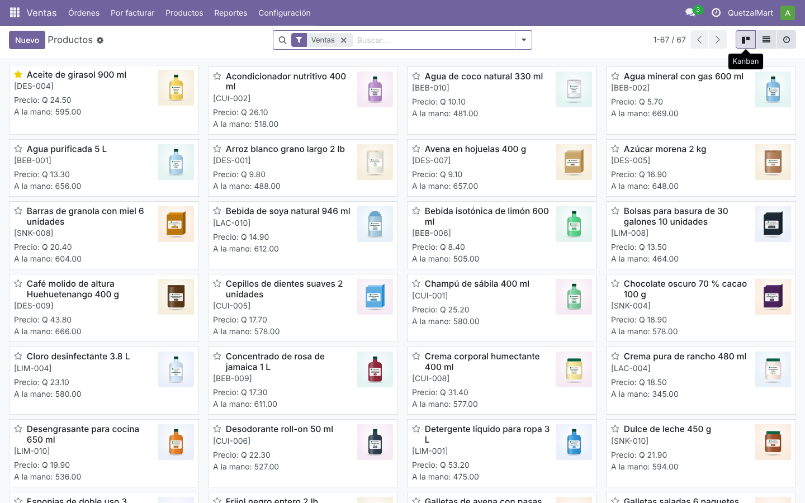
<p class="pie">Figura 25. Productos con imagen, precio y categoría.</p>

## 3.3 Órdenes de compra

1. *Compras ► Nuevo*: proveedor, productos y cantidades (el precio sale de la lista del proveedor).
2. **Enviar por correo** la solicitud de cotización y registrar la respuesta.
3. **Confirmar pedido** (si pasa de Q 10,000, un gerente la aprueba).
4. Botón **Recepción** ► revisar cantidades ► **Validar**.
5. **Crear factura** ► fecha de factura y número FEL del proveedor ► **Confirmar** ► **Registrar pago**.

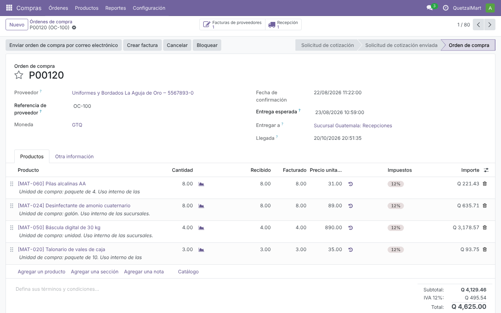
<p class="pie">Figura 26. Orden de compra confirmada con su recepción y factura.</p>

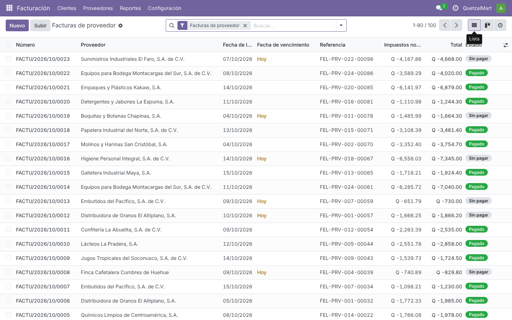
<p class="pie">Figura 27. Facturas de proveedor publicadas.</p>

## 3.4 Ventas y cotizaciones

1. *Ventas ► Nuevo*: cliente, almacén y equipo de la sucursal, productos.
2. **Enviar por correo** la cotización; al aceptarla, **Confirmar**.
3. Botón **Entrega** ► **Validar**.
4. **Crear factura** ► **Confirmar** ► **Registrar pago**.

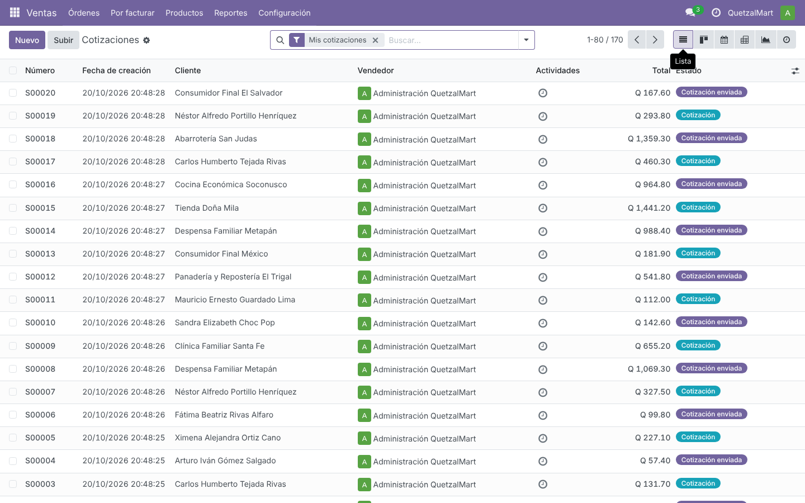
<p class="pie">Figura 28. Cotizaciones de venta (borrador y enviadas).</p>

## 3.5 Clientes en el CRM

Los clientes se registran en *Contactos* (o al crear su cuenta en la tienda) y sus oportunidades
se siguen en el embudo del CRM: *Nuevo ► Calificado ► Propuesta ► Ganado*. Una compra en la tienda
crea automáticamente una oportunidad ganada ligada al pedido.

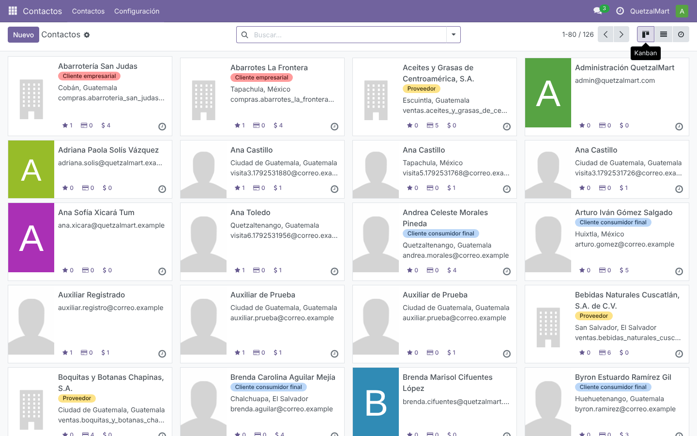
<p class="pie">Figura 29. Contactos de clientes y proveedores.</p>

## 3.6 Administración de empleados

Cada empleado tiene puesto, departamento, ubicación de trabajo (sucursal), jefe inmediato, DPI,
correo y contrato. Los contratos vigentes se consultan en *Empleados ► Contratos*.

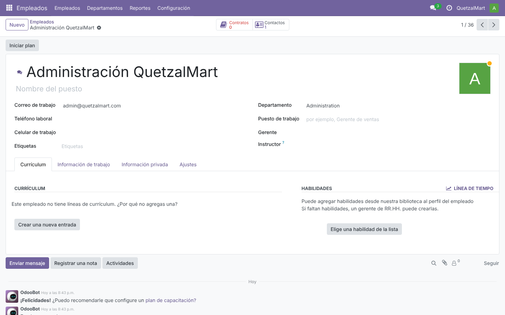
<p class="pie">Figura 30. Ficha de un empleado.</p>

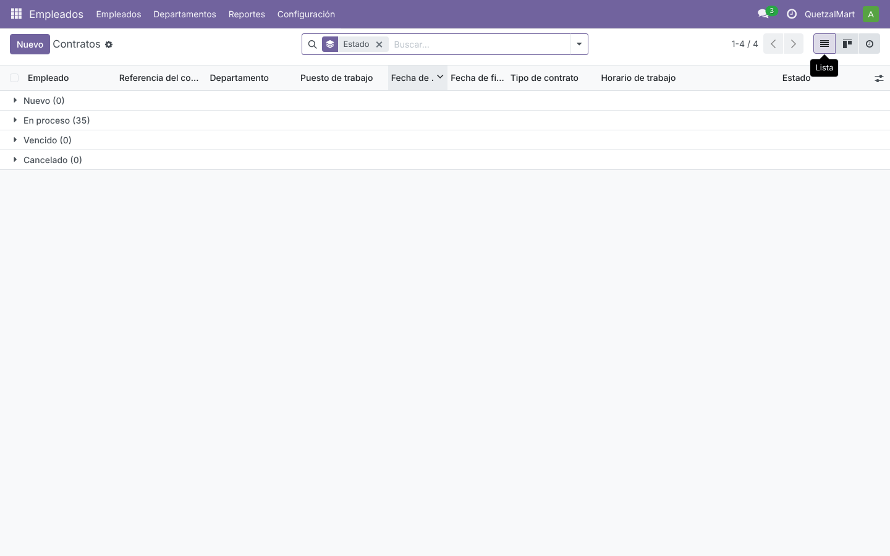
<p class="pie">Figura 31. Contratos de trabajo vigentes.</p>

## 3.7 Generación de facturas

Las facturas se crean desde el pedido (ventas) o la orden (compras) y se publican con
**Confirmar**. Al publicar una factura de cliente, el módulo `qm_gestion_documental` genera su PDF
y lo guarda en *Documentos ► Archivo QuetzalMart ► Facturas de venta* con la etiqueta de la
sucursal; las facturas de la calificación aparecen allí al momento.

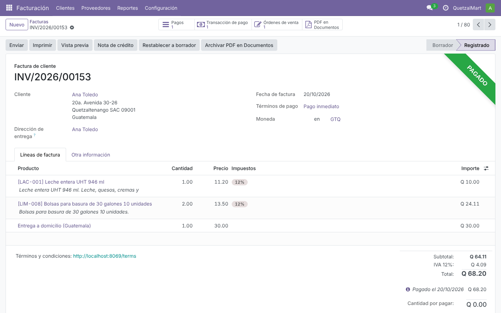
<p class="pie">Figura 32. Factura de cliente publicada con el botón «PDF en Documentos».</p>

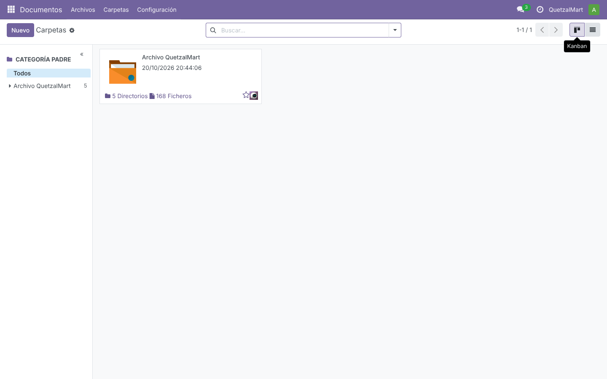
<p class="pie">Figura 33. Carpetas del archivo de QuetzalMart.</p>

# 4. RPA con UiPath

## 4.1 Problema que resuelve

El departamento de ventas guarda información en carpetas y libros de Excel con nombres poco
prácticos (*clientes - …*, *proveedores - …*, *reclamos - …*, *registro - …*, *productos - …*).
Cada libro tiene varias hojas y solo interesan **clientes** y **productos**, que vienen en la
**5.ª posición**. El robot extrae esa información, la consolida y la carga en la base centralizada
(Odoo), desde donde se ve en la tienda en línea y en la base de datos.

## 4.2 Diseño


## 4.3 Construcción paso a paso en UiPath Studio

El proyecto está en `rpa/QuetzalMart_Robot`. Las actividades de **Main.xaml**:

| # | Actividad | Configuración |
|---|---|---|
| 1 | *Seleccionar carpeta* | Guarda la carpeta raíz en `carpetaRaiz`. |
| 2 | *Asignar* | `archivos = Directory.GetFiles(carpetaRaiz, "*.xls*", SearchOption.AllDirectories)` sin los temporales `~$`. |
| 3 | *Invocar código* «Crear tabla de reporte» | Crea `dtReporte`. |
| 4 | *Para cada* archivo + *Intentar/Capturar* | Si un archivo falla se anota y se sigue con el siguiente. |
| 5 | *Invocar código* «Listar las hojas del libro en orden» | Lee `xl/workbook.xml` y devuelve las hojas en orden. |
| 6 | *Para cada* tipo (`clientes`, `productos`) + *Invocar código* «Elegir la hoja» | 5.ª posición o, si no, por nombre. |
| 7 | *Leer rango* (libro de trabajo) | Hoja elegida con encabezados, sin abrir Excel. |
| 8 | *Invocar código* «Normalizar clientes / productos» | Nombres técnicos de Odoo, valores normalizados, sin duplicados. |
| 9 | *Agregar fila de datos* | Anota archivo, hoja, posición y registros en el reporte. |
| 10 | *Escribir rango* | `consolidado_clientes.xlsx` y `consolidado_productos.xlsx`. |
| 11 | *Invocar archivo de flujo* `ImportarEnOdoo.xaml` | Una vez por consolidado. |
| 12 | *Escribir rango* y *Cuadro de mensaje* | `reporte_robot.xlsx` y resumen final. |

**ImportarEnOdoo.xaml:** *Abrir navegador* (Chrome) en la URL de importación ► *El elemento
existe* (pide inicio de sesión) ► *Hacer clic* en «Subir archivo de datos» ► *Escribir en* la
ventana Abrir con la ruta y Enter ► *Hacer clic* en «Probar» ► *El elemento existe* «Todo parece
correcto» (si no lo lee, deja un aviso en el registro) ► *Hacer clic* en «Importar». Si el archivo
tuviera errores, Odoo no importa nada y los muestra en la misma pantalla.

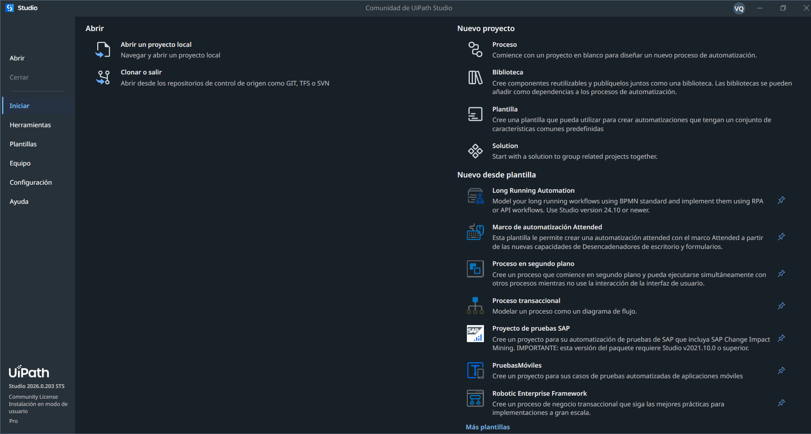
<p class="pie">Figura 34. UiPath Studio Community 2026 listo para abrir el proyecto local.</p>

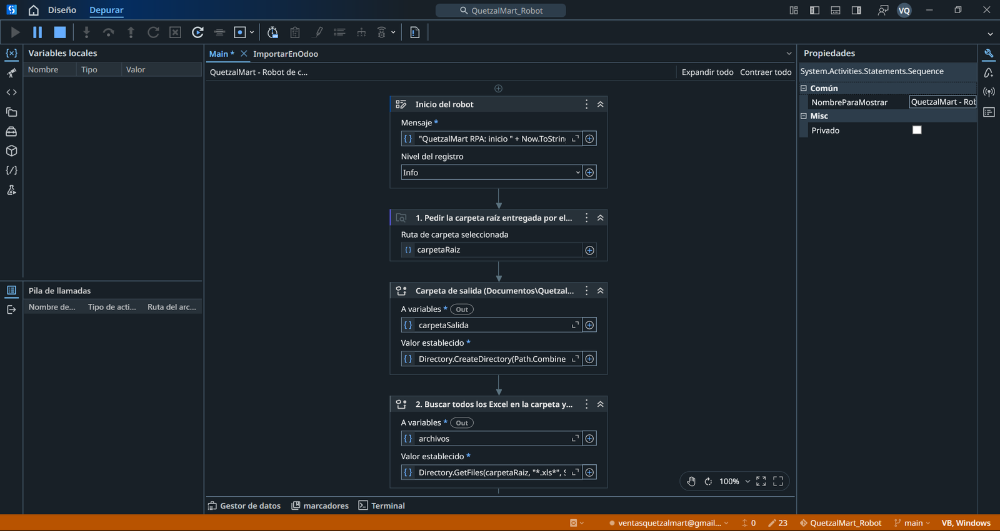
<p class="pie">Figura 35. Main.xaml en ejecución: inicio, selección de la carpeta raíz y búsqueda de los Excel.</p>


## 4.4 Ejecución y resultado

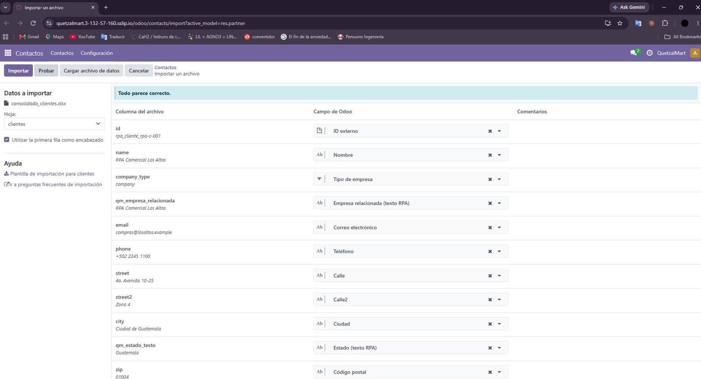
<p class="pie">Figura 36. El robot sube consolidado_clientes.xlsx a Odoo y pulsa Probar: «Todo parece correcto».</p>

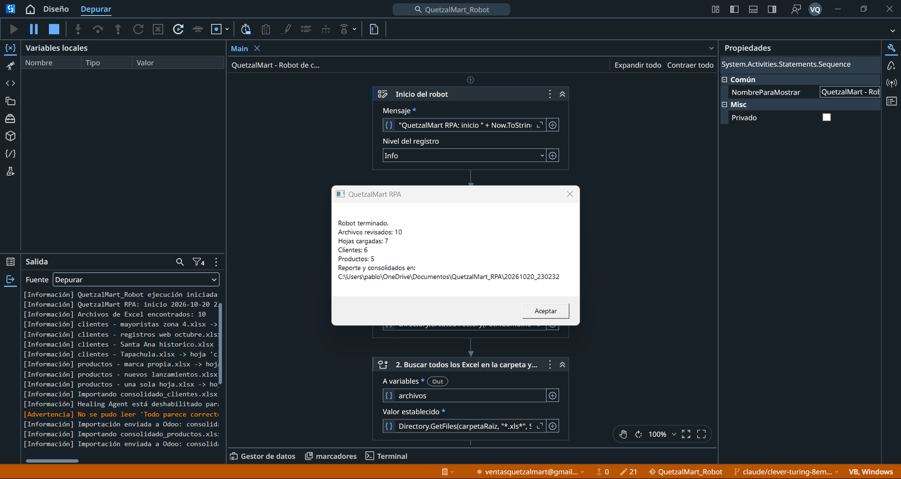
<p class="pie">Figura 37. Resumen final del robot: 10 archivos, 7 hojas, 6 clientes y 5 productos importados.</p>

Con la carpeta de prueba `rpa/carpeta_prueba` (10 libros en 5 carpetas de primer nivel y una
subcarpeta) el resultado fue:

| Archivo | Hoja | Posición | Agregados | Omitidos |
|---|---|---|---|---|
| clientes - mayoristas zona 4.xlsx | clientes | 5 | 3 | 1 (fila vacía) |
| clientes - registros web octubre.xlsx | Clientes␠ | 5 | 1 | 1 (duplicado) |
| clientes - Tapachula.xlsx | clientes | 5 | 1 | 0 |
| clientes - Santa Ana historico.xlsx | clientes | 5 | 1 | 0 |
| productos - marca propia.xlsx | productos | 5 | 1 | 0 |
| productos - nuevos lanzamientos.xlsx | productos | 5 | 3 | 1 (fila vacía) |
| productos - una sola hoja.xlsx | productos | 1 | 1 | 0 |
| proveedores, reclamos y registro | — | — | ignorados | — |

En Odoo quedaron 6 clientes (con país, estado, empresa relacionada y etiquetas resueltos) y 5
productos (4 bienes con su cantidad a la mano registrada y publicados en la tienda, y 1 servicio).
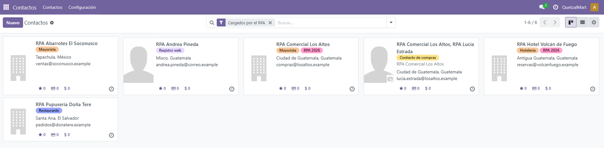
<p class="pie">Figura 38. Contactos con el filtro «Cargados por el RPA»: país, estado, empresa y etiquetas resueltos.</p>

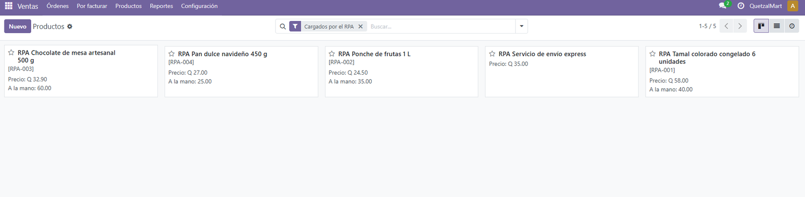
<p class="pie">Figura 39. Productos con el filtro «Cargados por el RPA», con precio y cantidad a la mano.</p>

Con los archivos de ejemplo del auxiliar: 4 clientes y 7 productos. Verificación SQL: sección 9 de
`sql/consultas_calificacion.sql`.

## 4.5 Ventajas de implementar el RPA

* **Ahorro de tiempo:** lo que a mano toma horas (abrir cada carpeta, buscar la hoja, copiar,
  corregir formatos e importar) el robot lo hace en minutos.
* **Calidad y consistencia:** aplica siempre las mismas reglas de formato, evita duplicados y se
  Odoo valida cada archivo antes de importarlo, así la base centralizada no recibe datos incompletos.
* **Trazabilidad:** cada registro guarda el archivo de origen y cada ejecución deja un reporte.
* **Escalabilidad:** con nuevas sucursales solo crecen las carpetas; el robot no cambia.
* **Mejor uso del personal:** ventas deja de copiar datos y se dedica a atender clientes.
