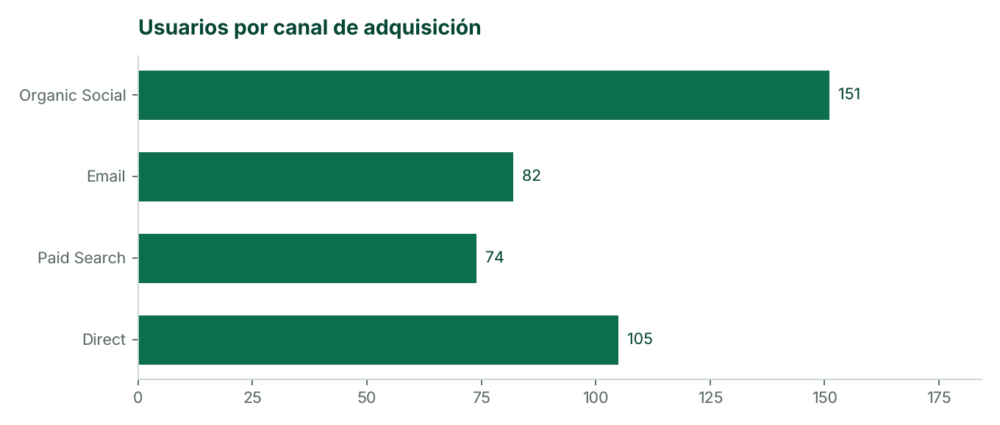
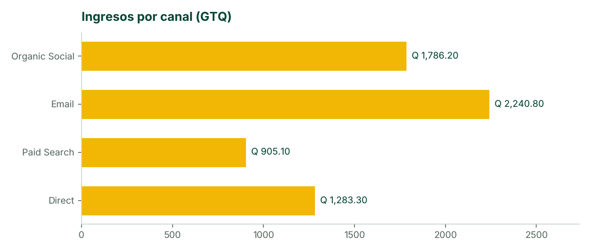
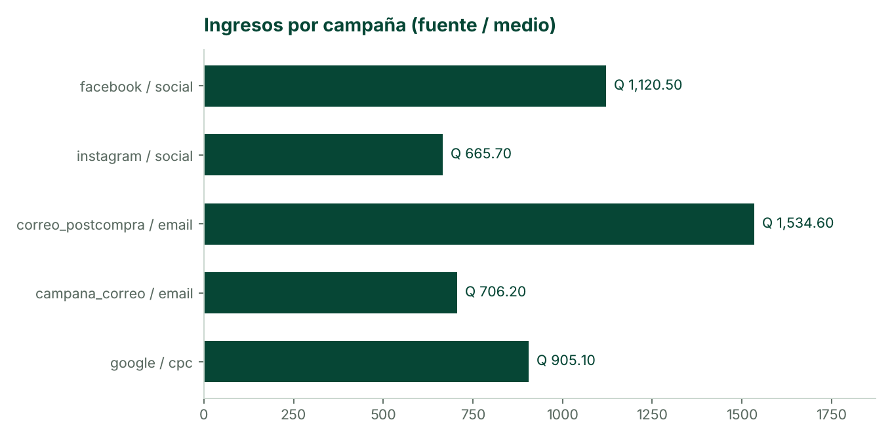
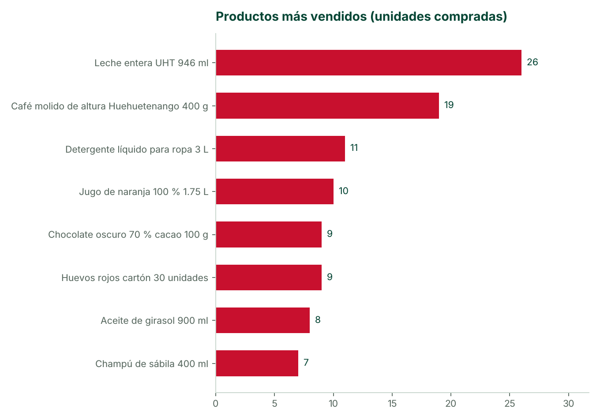
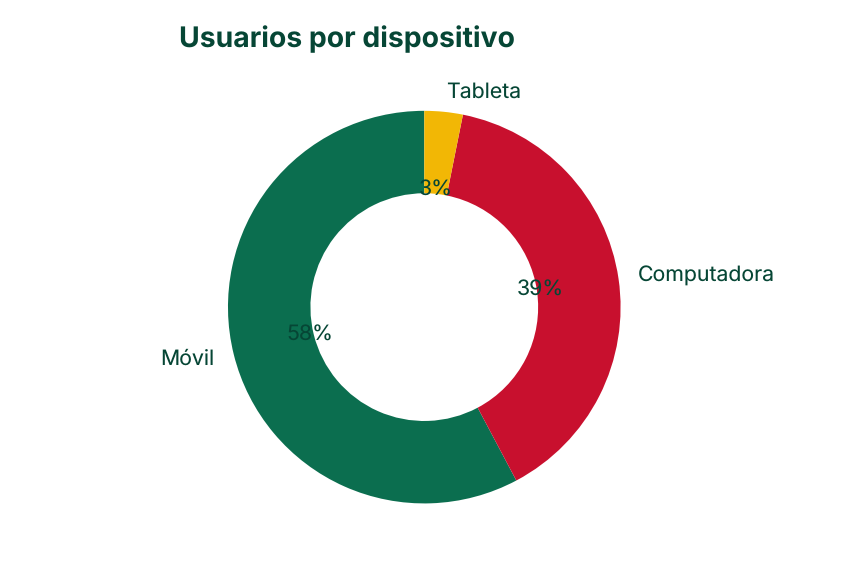

[TOC]

# 1. Resumen ejecutivo

Análisis de la tienda en línea de QuetzalMart con **Google Analytics 4** (propiedad
{{propiedad}}) para el periodo **{{periodo}}**. GA4 recibe los eventos de comercio electrónico
de la tienda (`view_item`, `add_to_cart`, `view_cart`, `begin_checkout`, `add_shipping_info`,
`add_payment_info`, `purchase`) con el SKU, la categoría y el precio de cada producto, y el origen
de cada visita mediante parámetros UTM.

| Indicador | Valor |
|---|---|
| Usuarios | {{resumen.usuarios}} ({{resumen.usuarios_nuevos}} nuevos) |
| Sesiones | {{resumen.sesiones}} |
| Vistas de página | {{resumen.vistas_de_pagina}} |
| Compras | {{resumen.compras}} |
| **Ingresos totales** | **{{calculado.ingresos}}** |
| Ticket promedio | {{calculado.ticket_promedio}} |
| **Tasa de conversión** (sesiones con compra) | **{{resumen.tasa_conversion}} %** |
| **Abandono de carrito** (agregaron y no compraron) | **{{calculado.abandono_carrito}}** |
| Tasa de rebote | {{resumen.tasa_rebote}} % |

**Conclusiones principales**

* El canal que más ingresos genera es **{{calculado.canal_ingresos}}** ({{calculado.canal_ingresos_monto}})
  y el que mejor convierte es **{{calculado.canal_conversion}}** ({{calculado.canal_conversion_pct}} de
  las sesiones terminan en compra); el que más usuarios trae es **{{calculado.canal_usuarios}}**.
* El producto más vendido es **{{calculado.producto_top}}** ({{calculado.producto_top_unidades}} unidades).
* La mayor pérdida del embudo ocurre en **{{calculado.peor_paso}}** ({{calculado.peor_paso_pct}} de los
  usuarios no continúa).
* **{{calculado.dispositivo_top}}** concentra el {{calculado.dispositivo_top_pct}} de los usuarios.

# 2. Adquisición de usuarios

¿De dónde llegan los clientes? (Informes ► Adquisición ► Adquisición de usuarios y de tráfico.)

{{tablas.adquisicion}}

## Campañas de marketing

Los enlaces de las publicaciones y de los correos llevan `utm_source`, `utm_medium` y
`utm_campaign`; así GA4 atribuye cada visita y compra a su campaña (Informes ► Adquisición ►
Adquisición de tráfico ► Campaña de la sesión).

{{tablas.campanas}}

**Lectura.** El correo postcompra llega a clientes que ya compraron, por eso convierte mejor: el
código QUETZAL10 les da un motivo para volver. Las redes sociales atraen más usuarios nuevos pero
con menor conversión, por lo que conviene dirigir esa inversión a la audiencia de carritos
abandonados en lugar de al público general.

# 3. Embudo de compra y abandono de carrito

(Explorar ► Exploración de embudo; Informes ► Monetización ► Recorrido de compra.)

{{tablas.embudo}}

* **Tasa de conversión del carrito:** {{calculado.conversion_carrito}} de quienes agregan un producto
  terminan comprando; el **abandono de carrito** es {{calculado.abandono_carrito}}.
* **Punto de fricción:** {{calculado.peor_paso}} ({{calculado.peor_paso_pct}} de pérdida).

# 4. Productos más vendidos

(Informes ► Monetización ► Compras de comercio electrónico.)

{{tablas.productos}}

**Lectura.** **{{calculado.producto_top}}** lidera las compras. **{{calculado.producto_oportunidad}}**
se ve mucho pero se compra poco: es candidato a promoción, mejor foto o descripción, o a un precio
de combo.

# 5. Dispositivos

La mayoría compra desde **{{calculado.dispositivo_top}}**: el proceso de pago debe revisarse
primero en ese tipo de pantalla.

# 6. Segmentos, exploraciones y audiencias

## Segmentos de usuarios (3)

{{tablas.segmentos_usuarios}}

## Segmentos de eventos (5)

{{tablas.segmentos_eventos}}

## Exploraciones (2)

{{tablas.exploraciones}}

Agregar capturas de GA4: las dos exploraciones con sus segmentos, la
pantalla de segmentos y la lista de audiencias.

## Audiencias (3, una personalizada de remarketing)

{{tablas.audiencias}}

# 7. Decisiones recomendadas

| Hallazgo | Acción | Indicador para medirla |
|---|---|---|
| El canal {{calculado.canal_conversion}} convierte más | Enviar la campaña de temporada a toda la lista de clientes cada quince días | Ingresos del canal Email |
| Abandono de carrito de {{calculado.abandono_carrito}} | Usar la audiencia *Carrito abandonado (7 días)* para anuncios con QUETZAL10 y activar el recordatorio de carrito de Odoo | Tasa de conversión del carrito |
| Mayor pérdida en {{calculado.peor_paso}} | Simplificar ese paso: mostrar el costo de envío antes y destacar *Recoger en sucursal* gratis | % que pasa al siguiente paso |
| {{calculado.producto_oportunidad}} se ve y no se compra | Promoción o combo con el producto más vendido | Compra / vista del producto |
| Predomina {{calculado.dispositivo_top}} | Revisar la tienda y el pago en ese dispositivo | Tasa de rebote por dispositivo |

# 8. Cómo se obtuvieron los datos

GA4 ► Resumen en tiempo real durante la generación de tráfico: usuarios activos,
audiencias y eventos de comercio electrónico.

* Propiedad GA4 conectada a Odoo (Sitio web ► Ajustes ► Google Analytics) y módulo
  `qm_ga4_ecommerce` para el embudo completo.
* Interacciones generadas navegando la tienda en computadora y teléfono, desde los correos de
  campaña y con `analytics/simular_trafico.py` (visitas con distintos orígenes UTM, abandonos y
  compras con el pago de prueba).
* Cifras tomadas de los informes de GA4 y registradas en `manuales/manual_3/datos_ga4.json`;
  las gráficas se generan con `python manuales/construir_manuales.py 3`.
