[TOC]

# 1. Resumen ejecutivo

Análisis de la tienda en línea de QuetzalMart con **Google Analytics 4** (propiedad
{{propiedad}}) para el periodo **{{periodo}}**. GA4 recibe los eventos de comercio electrónico
de la tienda (`view_item`, `add_to_cart`, `view_cart`, `begin_checkout`, `add_shipping_info`,
`add_payment_info`, `purchase`) con el SKU, la categoría y el precio de cada producto, y el origen
de cada visita mediante parámetros UTM.

| Indicador | Valor |
|---|---|
| Usuarios activos | {{resumen.usuarios}} ({{resumen.usuarios_nuevos}} nuevos) |
| Sesiones | {{resumen.sesiones}} ({{resumen.sesiones_interaccion}} con interacción: {{calculado.tasa_interaccion}}) |
| Eventos registrados | {{resumen.eventos}} |
| Usuarios que compraron | {{resumen.compradores}} |
| **Tasa de conversión** (usuarios que compran) | **{{calculado.conversion_usuarios}}** |
| Artículos comprados | {{resumen.articulos_comprados}} |
| **Ingresos por artículos** | **{{calculado.ingresos}}** (sin envío) |
| Ingreso promedio por comprador | {{calculado.ingreso_por_comprador}} |
| **Abandono de carrito** (embudo) | **{{calculado.abandono_carrito}}** |

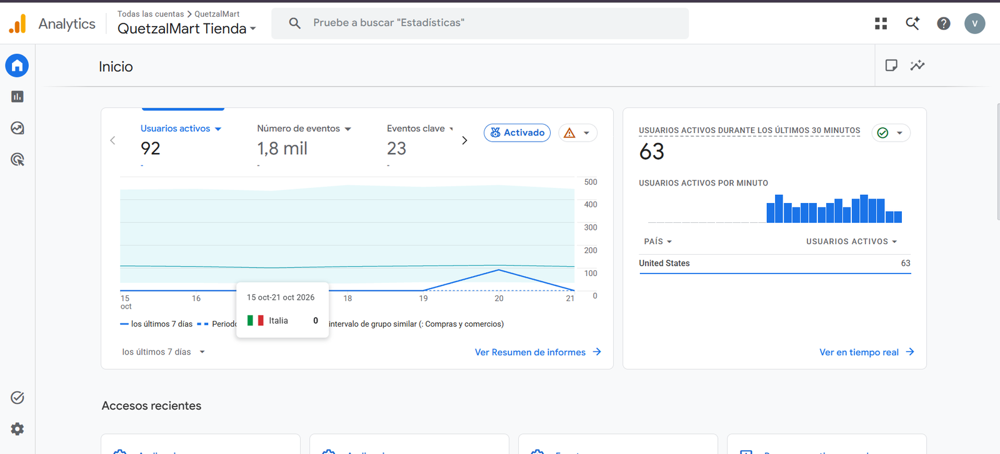

GA4 ► Inicio: usuarios activos, eventos y eventos clave de la semana.

**Conclusiones principales**

* {{calculado.canal_resumen}}; **{{calculado.canal_debil}}** es el
  único canal con sesiones sin interacción ({{calculado.canal_debil_pct}} de interacción).
* **{{calculado.producto_top}}** es el producto que más ingresos genera ({{calculado.producto_top_ingresos}})
  y **{{calculado.producto_unidades}}** el que más unidades vende.
* La mayor pérdida del embudo ocurre en **{{calculado.peor_paso}}** ({{calculado.peor_paso_pct}} no continúa).
* {{calculado.productos_sin_venta}} se agregan al carrito pero no se compran.

# 2. Adquisición de usuarios

¿De dónde llegan los clientes? (Informes ► Adquisición ► Adquisición de usuarios y de tráfico.)
Los enlaces de las publicaciones y de los correos llevan `utm_source`, `utm_medium` y
`utm_campaign`, así GA4 atribuye cada visita a su canal: redes sociales (*Organic Social*),
correos de campaña (*Email*), anuncios de búsqueda (*Paid Search*) y visitas directas.

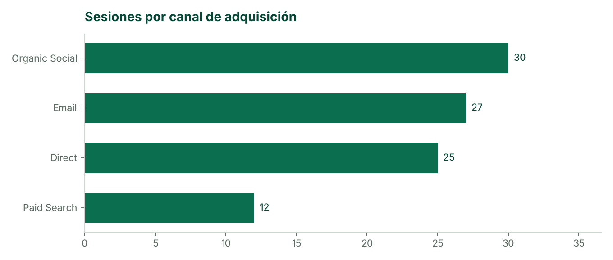

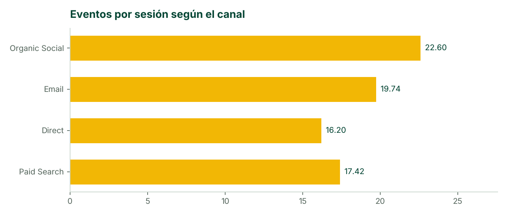

{{tablas.adquisicion}}

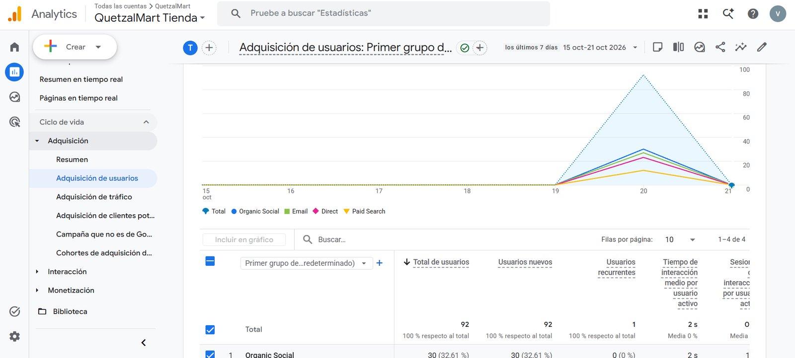

GA4 ► Adquisición de usuarios por primer grupo de canales.

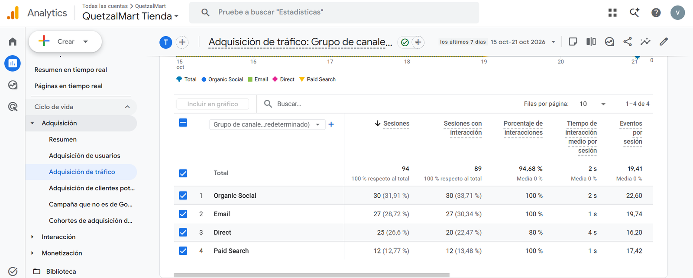

GA4 ► Adquisición de tráfico: sesiones, interacción y eventos por sesión por canal.

**Lectura.** Las redes sociales traen el mayor volumen de visitas y el correo casi lo iguala con
una interacción del 100 %: los clientes que ya compraron vuelven cuando reciben la campaña con
QUETZAL10. El tráfico directo es el único con sesiones sin interacción, por lo que la portada debe
llevar al catálogo y a las promociones de forma más visible.

## Páginas y países

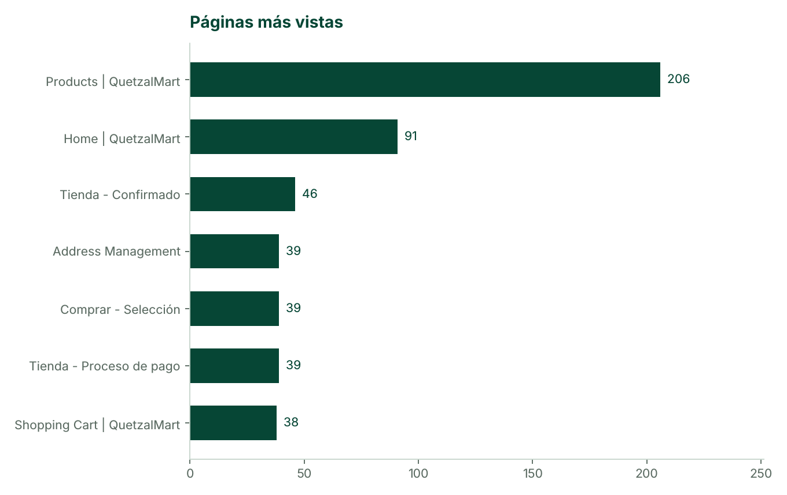

{{tablas.paginas}}

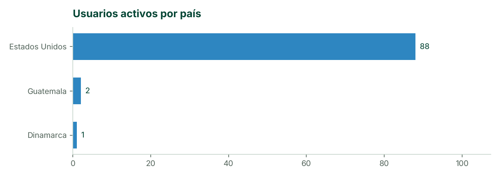

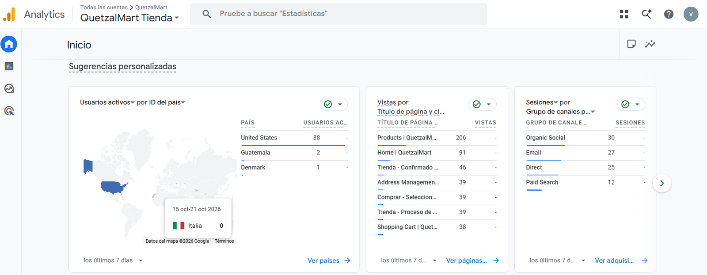

GA4 ► Inicio: usuarios por país, páginas más vistas y sesiones por canal.

La mayoría de visitas aparece en Estados Unidos porque el tráfico de prueba se generó desde el
servidor de AWS en Ohio; las visitas hechas desde Guatemala aparecen con su país real.

# 3. Embudo de compra y abandono de carrito

(Explorar ► Exploración de embudo *Embudo de compra QuetzalMart*, segmentos *Usuarios
compradores* y *Abandonaron el carrito*.)

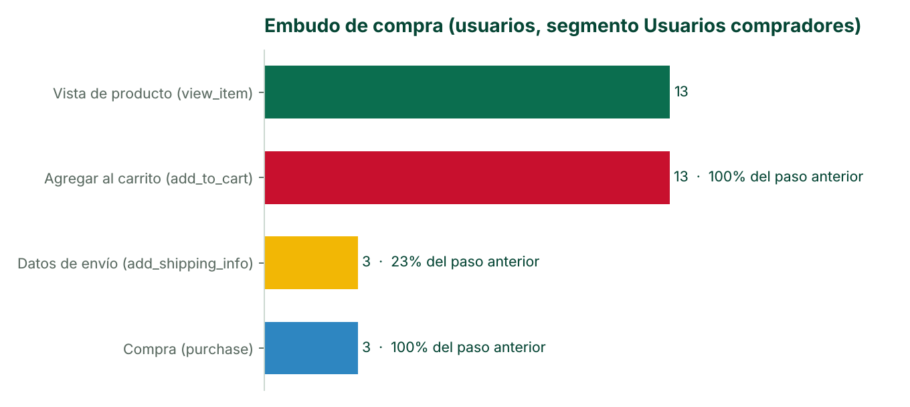

{{tablas.embudo}}

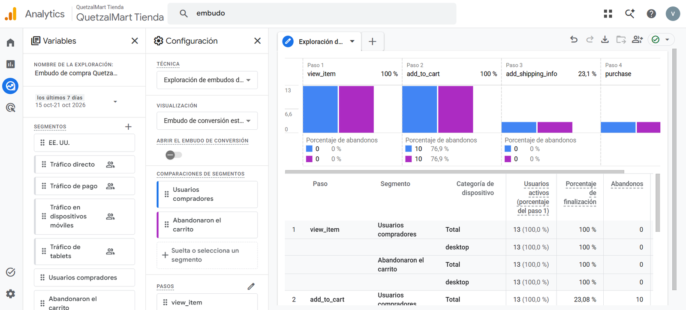

GA4 ► Exploración de embudo con los dos segmentos de usuarios comparados.

* **Abandono de carrito:** {{calculado.abandono_carrito}} de quienes agregan un producto no llega a
  comprar.
* **Punto de fricción:** {{calculado.peor_paso}} ({{calculado.peor_paso_pct}} de pérdida): el
  cliente agrega productos pero se detiene al llegar a la dirección y al costo de envío.

# 4. Productos más vendidos

(Explorar ► Formato libre *Productos por segmento*: filas *Nombre del artículo*; segmentos
`view_item`, `add_to_cart`, `purchase` y *Llegaron por correo*.)

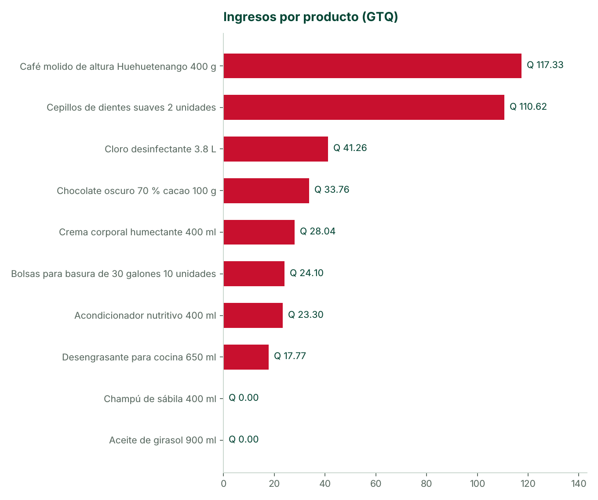

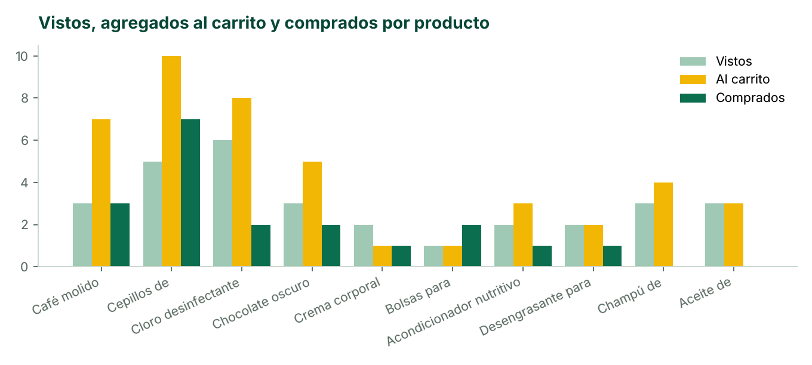

{{tablas.productos}}

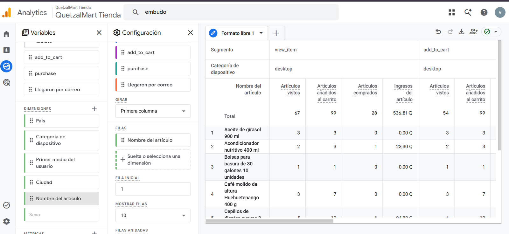

GA4 ► Exploración de formato libre con los segmentos de eventos.

**Lectura.** **{{calculado.producto_top}}** y **{{calculado.producto_unidades}}** concentran las
ventas. {{calculado.productos_sin_venta}} llegan al carrito pero no se compran: son candidatos a una
promoción o a un combo con los productos más vendidos.

# 5. Dispositivos

Todas las sesiones del periodo se registraron desde **computadora** (*desktop*); el proceso de
pago debe probarse también en teléfono antes de lanzar campañas en redes sociales, que se abren
mayormente desde el celular.

# 6. Segmentos, exploraciones y audiencias

## Segmentos de usuarios (3)

{{tablas.segmentos_usuarios}}

## Segmentos de eventos (5)

{{tablas.segmentos_eventos}}

## Exploraciones (2)

{{tablas.exploraciones}}

## Audiencias (3 propias, una personalizada de remarketing)

{{tablas.audiencias}}

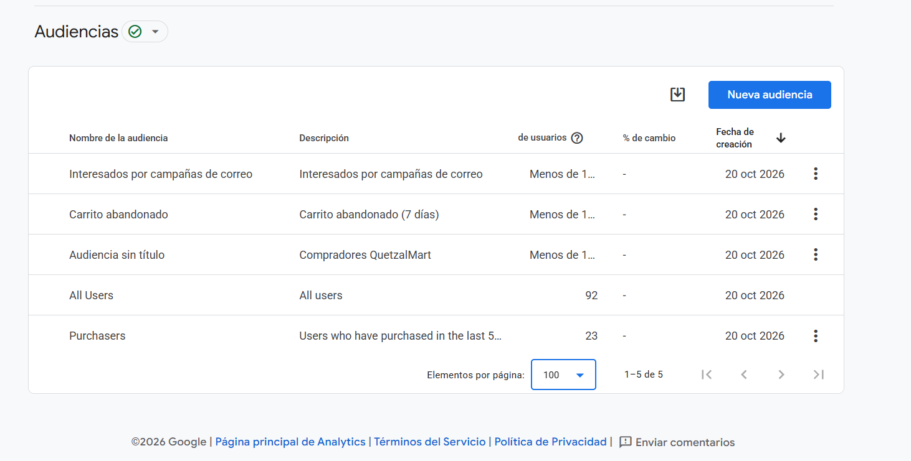

GA4 ► Administrar ► Audiencias. Las audiencias propias acumulan usuarios desde su
creación; GA4 muestra «Menos de 10» mientras no superan ese umbral.

# 7. Decisiones recomendadas

| Hallazgo | Acción | Indicador para medirla |
|---|---|---|
| El correo trae casi tantas sesiones como redes sociales y con 100 % de interacción | Enviar la campaña de temporada a toda la lista de clientes cada quince días | Sesiones y compras del canal Email |
| Abandono de carrito de {{calculado.abandono_carrito}} | Usar la audiencia *Carrito abandonado* para anuncios con QUETZAL10 y activar el recordatorio de carrito de Odoo | Tasa de conversión del carrito |
| Mayor pérdida en {{calculado.peor_paso}} | Mostrar el costo de envío desde el carrito y destacar *Recoger en sucursal* gratis | % que pasa al siguiente paso |
| {{calculado.productos_sin_venta}} se agregan y no se compran | Promoción o combo con {{calculado.producto_top}} | Comprados / agregados del producto |
| {{calculado.canal_debil}} tiene sesiones sin interacción | Portada con accesos directos a ofertas y categorías | Tasa de interacción del canal |

# 8. Cómo se obtuvieron los datos

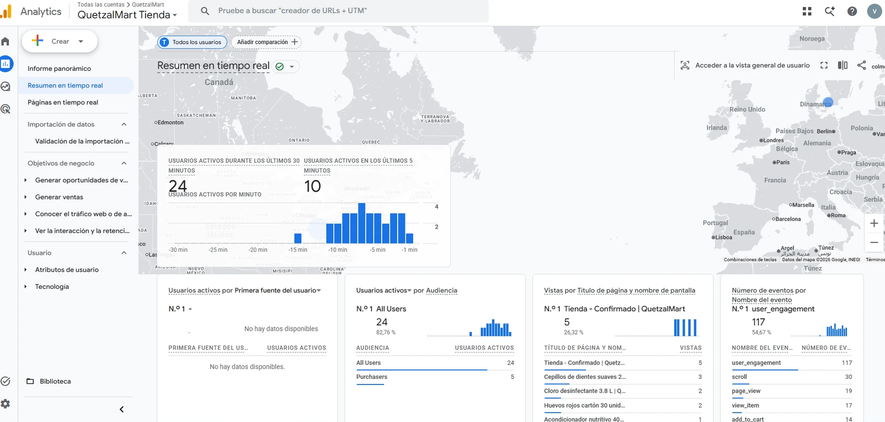

GA4 ► Resumen en tiempo real durante la generación de tráfico: usuarios activos,
audiencias y eventos de comercio electrónico.

* Propiedad GA4 conectada a Odoo (Sitio web ► Ajustes ► Google Analytics) y módulo
  `qm_ga4_ecommerce` para el embudo completo.
* Interacciones generadas navegando la tienda y con `analytics/simular_trafico.py` (visitas con
  distintos orígenes UTM, abandonos y compras con el pago de prueba).
* Cifras tomadas de los informes y exploraciones de GA4 del {{periodo}} y registradas en
  `manuales/manual_3/datos_ga4.json`; las gráficas se generan con
  `python manuales/construir_manuales.py 3`.
